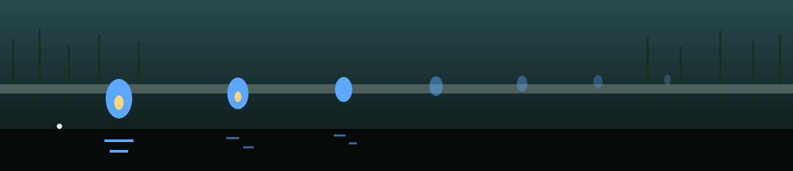

# Lex-Code-Trainer

<p align="center"></p>




Lex is the AI programming assistant done right.

# What makes Lex-Code-Trainer different?

Lex ensures that you are not copying and pasting code but rather
understanding each line. After Lex shows you code, only a single line is
revealed at a time, and you are asked to explain in technical detail what
that line is doing to reveal the next.


## Implementation

This project is complete and runnable, with no dependencies beyond the
Python 3 standard library. Run it:

```bash
python3 lex.py                  # list lessons
python3 lex.py --lesson loops   # study a lesson
python3 lex.py --file code.py   # line-by-line mode for your own code
```

There are three built-in lessons: `functions`, `loops`, and `api`.
In a lesson, each line is graded against its key concepts: your
explanation needs to mention at least half of them (stem matching, so
`accumulate` covers `accumul`) to be counted as correct enough. Typing
`skip` reveals the next line without credit. At the end, Lex prints your
understanding score as a percentage of the graded lines. Blank lines are
shown but not graded.

In `--file` mode your explanations are not graded: Lex shows each
non-blank line of your file and waits for you to type an explanation or
press Enter before revealing the next line.


## Behaviour verified by testing

- `python3 lex.py` lists the three lessons and exits 0.
  `--lesson` with an unknown name is rejected by argparse with exit 2.
- A fully correct run through the `functions` lesson scores 100 percent,
  including the f-string line: the concept `f-string` is matched by its
  word parts, so an explanation mentioning an f-string can earn that
  concept. The short parts of a hyphenated concept count only as a
  whole word: the `f` in `f-string` is not earned by words that merely
  start with f, such as `function` or `formats`. An explanation that
  names the f-string (or writes `fstring`) still earns it.
- Closing the input (EOF) or pressing Ctrl-C during a lesson stops the
  lesson without a traceback, exit 0. If any line was graded before
  the stop, the score printed is over the lines reached so far; if
  none was, no score line prints.
- `--file` with a missing path or a directory prints a short
  `Lex: cannot open ...` message to stderr and exits 1, with no traceback.
- Closing the input, or pressing Ctrl-C, part-way through `--file`
  mode ends with
  `File abandoned before the end.` instead of claiming the file was
  completed. A file read to the end ends with the `File complete.`
  message. An empty file completes immediately.
- If both `--file` and `--lesson` are given, `--file` takes precedence.


## Tests

```bash
python3 -m unittest
```

20 tests: `grade()` on its own (stem matching, the f-string
whole-word rule above, partial credit, empty input), scripted
lesson runs (full marks, all skips, EOF early and late, Ctrl-C),
and file mode (missing file, directory, empty file, read to the
end, abandoned early, Ctrl-C, `--file` winning over `--lesson`).


## Files

- `lex.py` - the whole program, lessons included
- `test_lex.py` - the test suite
- `LICENSE` - MIT License
